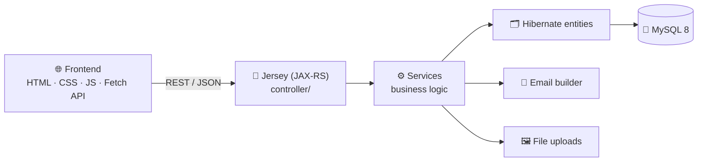

<div align="center">


<a href="https://github.com/Isuru-CodeX/SmartTrade">
  
</a>

<br/>

<p>
  
  
  
  
  
</p>

<p>
  
  
  
  
</p>

<p>
  <a href="#-features"><b>✨ Features</b></a> •
  <a href="#-architecture"><b>🏗️ Architecture</b></a> •
  <a href="#-getting-started"><b>🚀 Get Started</b></a> •
  <a href="#-project-structure"><b>📂 Structure</b></a> •
  <a href="#-roadmap"><b>🗺️ Roadmap</b></a>
</p>

</div>

---

## 📱 About

**SmartTrade** is a comprehensive **phone marketplace** web app with a modern Java backend and a custom, lightweight, responsive frontend. Users can browse phones, manage **wishlists** and **shopping carts**, and approved **sellers** can list new phones for sale.

Built for the **Web Programming II (HF2L)** module as a complete solution for buying and selling mobile devices.

<!--
📸 SCREENSHOTS: add your images to an /assets folder, then uncomment this block.

<div align="center">
  
  
  
  
</div>
-->

---

## ✨ Features

| | Feature | Details |
|---|---|---|
| 🔐 | **Authentication** | Sign-up, sign-in and account verification flows |
| 🏪 | **Seller accounts** | Approved sellers create and manage product listings |
| 📚 | **Product catalogue** | Advanced search, filters (brand, model, price…), sorting and pagination |
| 🛒 | **Cart and wishlist** | Stored server-side with Hibernate entities and a REST API, not just in the browser |
| 🎨 | **Responsive design system** | Custom dark theme (ink, brand green, highlight) with mobile menu, filter drawer and cart drawer |
| ⚡ | **Live search** | Instant search overlay, open it with <kbd>/</kbd> or <kbd>Ctrl</kbd> + <kbd>K</kbd> |
| ✍️ | **Rich product descriptions** | Built-in rich text editor with strict server-side HTML sanitization (XSS-safe) |
| 📧 | **Automated emails** | HTML email template builder for verification and password reset |
| 🖼️ | **Secure image uploads** | Collision-resistant product and profile image uploads stored locally |

---

## 🏗️ Architecture



---

## 🛠️ Tech Stack

<div align="center">


</div>

| Layer | Technologies |
|---|---|
| **Frontend** | HTML5, CSS3, Vanilla JavaScript, Fetch API |
| **Backend** | Java 17, Jersey 2 (JAX-RS), Servlet 4.0 |
| **Database** | MySQL 8.x, Hibernate 5.6 |
| **Server** | Apache Tomcat **9.0.x** (needs the `javax.*` namespace) |
| **Tools** | Git, GitHub, Maven 3.8+ |

---

## 🚀 Getting Started

### ✅ Prerequisites

- ☕ JDK 17
- 📦 Maven 3.8+
- 🐱 Apache Tomcat **9.0.x** *(must be 9.0.x, not 10+)*
- 🐬 MySQL 8.x
- 🔧 Git

### 📥 Installation

```bash
# 1️⃣ Clone the repository
git clone https://github.com/Isuru-CodeX/SmartTrade.git
cd SmartTrade

# 2️⃣ Build the project
mvn clean package
```

### 🗄️ Database setup

```bash
# Schema + lookup data
mysql -u root -p < database/smarttrade.sql

# (Optional) demo seller and sample products
mysql -u root -p < database/smarttrade_demo_data.sql
```

> 🔑 **Demo login** (if the demo script ran): `demo@smarttrade.lk` / `Demo@1234`, a verified, approved seller.

Then set your connection details in `src/main/resources/hibernate.cfg.xml`. `hbm2ddl.auto=update` is enabled to keep the schema in sync.

### ⚙️ Configuration

Settings are read from **environment variables first**, then `src/main/resources/app.properties` (via the `Env.java` utility):

```properties
app.url=http://localhost:8080/smarttrade/
mail.smtp.host=smtp.example.com
mail.smtp.port=587
mail.username=your_username
mail.password=your_password
```

> 🔒 **Never commit real passwords or API keys.** Environment variables use uppercase underscore names, e.g. `APP_URL`.

### ▶️ Run it

<details open>
<summary><b>💻 Command line</b></summary>

<br/>

```bash
mvn clean package
cp target/smarttrade.war $CATALINA_HOME/webapps/
$CATALINA_HOME/bin/startup.sh      # on Windows: startup.bat
```

Open **http://localhost:8080/smarttrade/**

</details>

<details>
<summary><b>🧠 IntelliJ IDEA</b></summary>

<br/>

1. **Run → Edit Configurations → Add New → Tomcat Server (Local)**
2. Select your Tomcat **9** home directory
3. In **Deployment**, add the artifact `smarttrade:war exploded`
4. Set the application context to `/smarttrade`

*(Optional)* Run `lk.jiat.smarttrade.Main` for an embedded Tomcat 9. Enable "Add dependencies with provided scope to classpath" in the run configuration.

</details>

---

## 📂 Project Structure

```bash
SmartTrade/
├── 📁 src/main/
│   ├── 📁 java/lk/jiat/smarttrade/
│   │   ├── 📁 controller/     # Jersey REST API endpoints
│   │   ├── 📁 dto/            # Data Transfer Objects
│   │   ├── 📁 entity/         # Hibernate / JPA entities
│   │   ├── 📁 service/        # Business logic
│   │   └── 📁 util/           # Env.java, HibernateUtil.java
│   ├── 📁 resources/          # app.properties, hibernate.cfg.xml
│   └── 📁 webapp/
│       ├── 📁 WEB-INF/        # web.xml
│       ├── 📁 assets/         # CSS, JS, fonts, images
│       ├── 📁 uploads/        # Product and profile images
│       └── 📄 *.html          # Frontend views
├── 📁 database/               # Schema and demo-data SQL
├── 📄 pom.xml
└── 📄 README.md
```

---

## 🧪 Testing

```bash
mvn test
```

> ℹ️ There are no automated tests yet, so `mvn test` mainly verifies that the project compiles.

---

## ⚠️ Known Issues

- 💳 **Orders and payments:** there is currently no backend order processing or payment gateway. The checkout page validates the form and explains this limitation.
- 🏪 **Seller registration:** products can only be listed if a row exists in the `seller` table with status `APPROVED`. There's no self-service seller registration screen yet.
- 🔐 **Passwords:** currently stored in plain text and returned by `api/profiles/user-profile`. **Hash them (e.g. BCrypt) before any production use.**
- 🔑 **Credentials:** database and SMTP credentials live in plain-text config. Prefer environment variables when deploying.

---

## 🗺️ Roadmap

- [x] Product catalogue with search, filters, sorting and pagination
- [x] Server-side cart and wishlist via REST API
- [x] Seller listings with a sanitized rich text editor
- [x] Verification and password-reset emails
- [ ] Secure password hashing (BCrypt)
- [ ] Backend order processing and payment gateway
- [ ] Self-service seller registration and approval workflow
- [ ] Environment-variables-only configuration for production

---

## 🤝 Contributing

1. 🍴 Fork the repository
2. 🌿 Create a branch: `git checkout -b feature-branch`
3. 💾 Commit: `git commit -m "Add some feature"`
4. 📤 Push: `git push origin feature-branch`
5. 🔃 Open a Pull Request

## 📜 License

Developed for **educational purposes**. It is currently not licensed under a specific open-source license.

---

<div align="center">

### 📬 Connect with me

<a href="https://github.com/Isuru-CodeX"></a>

⭐ **If you like SmartTrade, give it a star!** ⭐


</div>